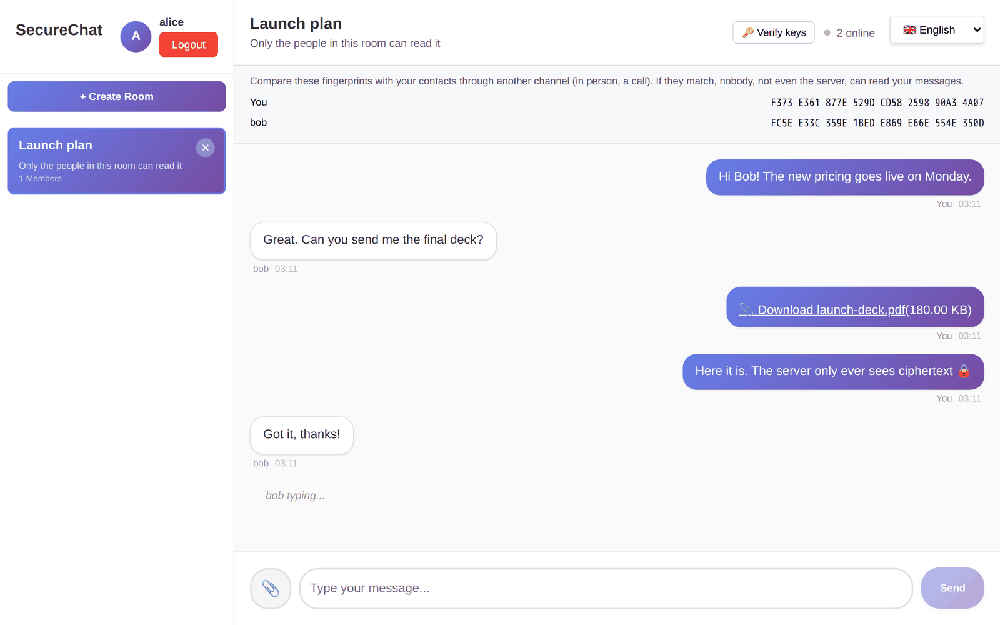

<h1 align="center">SecureChat</h1>

<p align="center">
  <b>Self-hosted, end-to-end encrypted group chat.</b><br>
  The server never sees your messages, your files or your password.
</p>

<p align="center">
  <a href="https://github.com/luuuccasss/SecureChat/actions/workflows/ci.yml"></a>
  <a href="LICENSE"></a>
  
  
</p>

<p align="center"></p>

## Features

- **End-to-end encryption** for messages and files, in the browser with the Web Crypto API
- **Zero-knowledge accounts**: the password is turned into keys locally and never sent
- **Works on any device**: your private key is stored sealed on the server and unlocked at login
- **Group rooms** with automatic key sharing, and a new key whenever someone leaves or is banned
- **Key fingerprints** to verify members out of band
- **Moderation**: roles, bans, slow mode, read-only rooms, audit log
- Real-time with Socket.IO, English and French UI, self-hosted on Node.js + MySQL

## How the encryption works

1. Your password goes through PBKDF2 (600k iterations), then HKDF: one key logs you in, the other seals your RSA-3072 private key. Only the first one reaches the server.
2. Each room has random AES-256 keys, wrapped separately for every member's public key.
3. Messages are bound to their room, key version and sender, so the server cannot move or re-attribute them.

This is what the server stores for a message:

```
id  senderId  content                                            iv                keyVersion
1   1         YmEgzExboQ/cJryBJc2R5UhS5mfvU6vajOyQDZcSnUtNmEvn…  RlLwHJY+54rSaoZD  1
```

Details, threat model and limits: [SECURITY.md](SECURITY.md).

## Quick start

```sh
git clone https://github.com/luuuccasss/SecureChat.git && cd SecureChat
mysql -u root -p < server/database/schema.sql

cd server && npm install && cp .env.example .env   # set JWT_SECRET, DB_USER, DB_PASSWORD
node index.js

cd ../client && npm install && npm start            # http://localhost:3000
```

Production setup (HTTPS, nginx, build, migrations): [docs/DEPLOYMENT.md](docs/DEPLOYMENT.md).

## Tests

31 integration tests run against a real server and MySQL on every push, including end-to-end scenarios with the actual browser crypto code: ciphertext-only storage, members leaving, forged senders, concurrent key rotations.

```sh
cd server && SC_URL=http://localhost:3001 npm test
```

## Documentation

[Architecture](docs/ARCHITECTURE.md) · [Database schema](docs/SCHEMA.md) · [Deployment](docs/DEPLOYMENT.md) · [Security](SECURITY.md) · [Contributing](CONTRIBUTING.md) · [Changelog](CHANGELOG.md)

## License

[MIT](LICENSE) · See also the [disclaimer](DISCLAIMER.md) and [legal notice](LEGAL_NOTICE.md).
